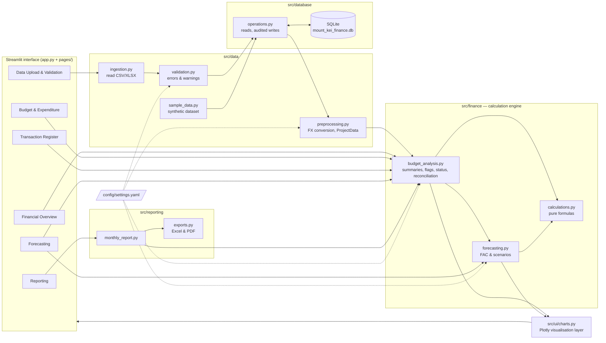
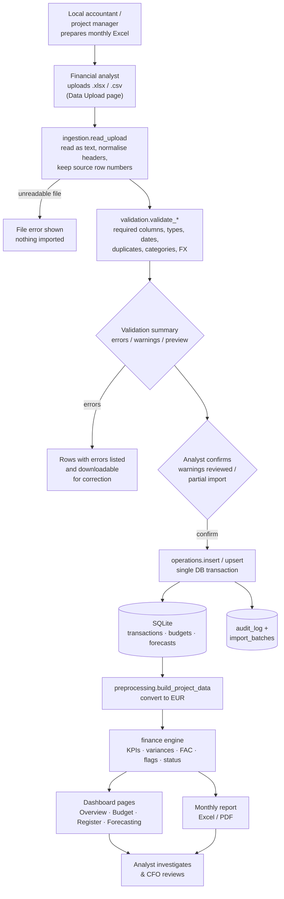
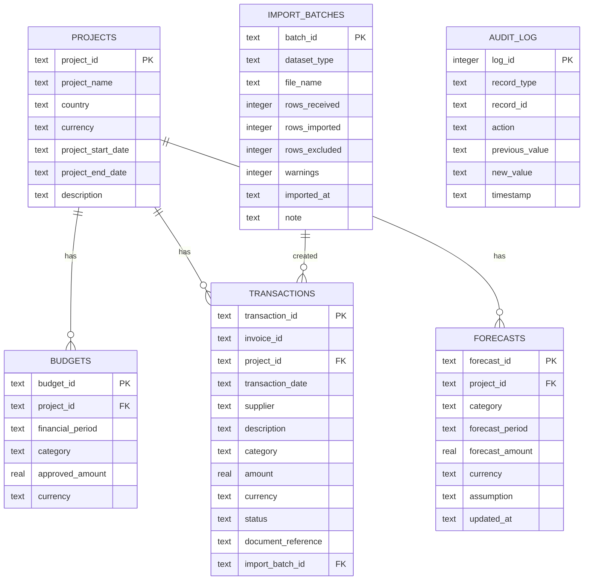
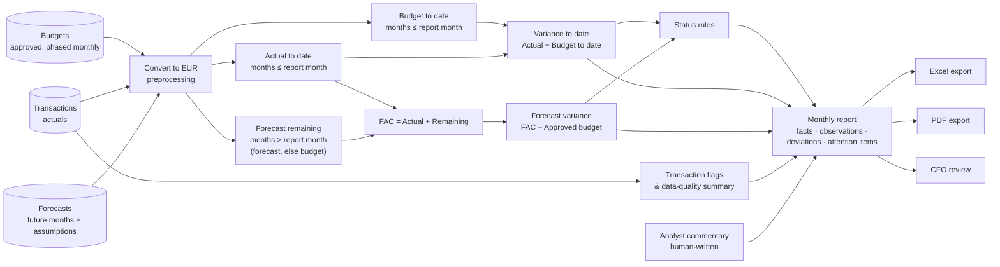

# Architecture — Mount Kei Finance Intelligence

This document explains how the application is built, so that another developer can maintain or extend it without
reverse-engineering the code. Financial definitions are in `FINANCIAL_LOGIC.md` and field definitions are in
`DATA_DICTIONARY.md`.

---

## 1. System overview

A local, single-user Streamlit web application backed by a SQLite file. The analyst uploads Excel or CSV files from
local accountants. The files are **ingested** (read as text), **validated** (row-level errors and warnings), and on
confirmation **persisted** to SQLite with an audit trail. Every page then reads the database, **preprocesses** it
(currency conversion to EUR), and calls the **financial engine** (pure Python functions) for KPIs, variances,
forecasts, flags and status. **Visualisation** and **reporting** modules only present engine output.

Design principles:
- **Calculations are separate from the UI.** Pages contain no financial formulas. Everything lives in `src/finance`
  and is unit tested.
- **Deterministic and traceable.** There is no ML and no AI. Every number traces to stored rows, and every change is
  audited.
- **Configuration over code.** Categories, thresholds, FX rates and scenarios live in `config/settings.yaml`.
- **Nothing silently discarded.** Invalid rows are reported, never dropped quietly.

### Diagram 1 — System architecture



## 2. Technology choices

| Component | Choice | Reason |
|---|---|---|
| Language | Python 3.10+ | Analyst-friendly; the same language for data processing, finance logic and tests |
| Web UI | Streamlit 1.37+ (`st.navigation`) | A working multi-page app with no frontend build; tables, filters, uploads and downloads included |
| Data processing | Pandas | The standard for tabular finance data and Excel I/O |
| Charts | Plotly | Interactive hover, works natively in Streamlit |
| Storage | SQLite (stdlib `sqlite3`) | No server needed, a single file, ACID transactions for safe imports, persists across restarts |
| Excel | OpenPyXL (via Pandas) | Read uploads, write templates and the formatted Excel report |
| PDF | ReportLab | Pure-Python PDF generation with tables and pagination, no system dependencies |
| Config | YAML (PyYAML) | Human-editable by a finance user |
| Tests | Pytest + Streamlit `AppTest` | Unit tests for formulas and validation; headless smoke tests for every page |

No ORM is used. The schema is small, and plain SQL in one module (`operations.py`) is easier to audit.

## 3. Folder structure

```
mount_kei_finance_intelligence/
├── app.py                         # entry point: page config + navigation only
├── requirements.txt
├── README.md
├── .streamlit/config.toml         # theme (light, forest-green accent)
├── config/settings.yaml           # categories, FX rates, thresholds, scenarios   [added vs. brief]
├── pages/                         # one file per page — layout & widgets only
│   ├── 01_Financial_Overview.py
│   ├── 02_Budget_Expenditure.py
│   ├── 03_Transaction_Register.py
│   ├── 04_Forecasting.py
│   ├── 05_Data_Upload.py
│   └── 06_Reporting.py
├── src/
│   ├── data/        ingestion.py · validation.py · preprocessing.py · sample_data.py
│   ├── finance/     calculations.py · budget_analysis.py · forecasting.py
│   ├── database/    connection.py · models.py · operations.py
│   ├── reporting/   monthly_report.py · exports.py
│   ├── ui/          layout.py · components.py · charts.py · navigation.py · assets/theme.css   [added vs. brief]
│   └── utils/       config.py · formatting.py
├── data/
│   ├── sample/      generated CSV/XLSX dataset + example upload files
│   ├── templates/   upload templates (.csv and .xlsx with an instructions sheet)
│   └── database/    mount_kei_finance.db (git-ignored; recreated on first run)
├── docs/            ARCHITECTURE · DATA_DICTIONARY · FINANCIAL_LOGIC · SOURCE_REGISTER · CHANGELOG
└── tests/           test_calculations · test_validation · test_database · test_reporting · test_pages_smoke
```

**Changes from the recommended structure (and why):**
- `config/settings.yaml` was added so finance users can change thresholds, categories and FX rates without touching code.
- `src/ui/` was added so that the six pages share one application shell, one stylesheet, one set of components and
  one chart style. This removes duplication and keeps presentation code out of the page files and the finance engine
  (see §4a).
- `tests/test_reporting.py` and `tests/test_pages_smoke.py` were added to cover exports and to render every page
  headlessly.
- `app.py` uses `st.navigation(position="hidden")` with the page list from `src/ui/navigation.py`. The landing page
  is the Financial Overview, URLs are clean (`/budget`, `/transactions`, …), and the sidebar is drawn by
  `layout.py` with `st.page_link`, so all six pages stay visible (Streamlit's own nav collapses after five).

## 4. Module reference

| Module | Responsibility | Key functions |
|---|---|---|
| `app.py` | Page config, page registration (hidden built-in nav) | `PAGES` |
| `src/ui/navigation.py` | Single list of pages: key, script, title, Material icon, URL | `NAV` |
| `src/utils/config.py` | Load YAML once; typed accessors; resolve paths | `load_config`, `categories`, `fx_rates`, `status_rules`, `scenarios` |
| `src/utils/formatting.py` | Display formatting only | `fmt_money`, `fmt_money_short`, `fmt_pct`, `period_label` |
| `src/database/connection.py` | Open connections (foreign keys on); transaction context | `get_connection`, `db_session` |
| `src/database/models.py` | DDL for all tables and indexes; canonical column lists | `SCHEMA_SQL`, `TABLE_COLUMNS`, `init_db` |
| `src/database/operations.py` | **All** reads and writes; audit log; import batches; seed/reset | `get_*`, `insert_transactions`, `upsert_budgets`, `upsert_forecasts`, `update_transaction_status/category`, `data_version` |
| `src/data/ingestion.py` | Read CSV/XLSX as text; normalise headers (aliases); keep source row numbers | `read_upload`, `normalise_column` |
| `src/data/validation.py` | Schema and row rules per dataset; returns `ValidationResult` (issues, clean, excluded) | `validate_transactions`, `validate_budget`, `validate_forecast`, `parse_amount`, `parse_date` |
| `src/data/preprocessing.py` | Currency conversion; derived columns; `ProjectData` container; completeness warnings | `convert_to_base`, `build_project_data` |
| `src/data/sample_data.py` | Deterministic synthetic dataset, example uploads, templates; CLI | `generate_all`, `seed_database_from_sample`, `write_templates` |
| `src/finance/calculations.py` | Pure formulas (no pandas state, no UI) | `total_approved_budget`, `total_actual_expenditure`, `remaining_budget`, `budget_variance`, `variance_percentage`, `budget_utilisation`, `forecast_at_completion`, `forecast_budget_variance` |
| `src/finance/forecasting.py` | Remaining-spend forecast, FAC, scenarios, run-rate | `forecast_remaining_detail`, `forecast_by_category`, `forecast_totals`, `scenario_comparison`, `run_rate_forecast` |
| `src/finance/budget_analysis.py` | KPIs, category and monthly summaries, flags, data quality, status, reconciliation, attention items | `headline_kpis`, `category_summary`, `category_table_for_periods`, `monthly_summary`, `monthly_budget_vs_actual`, `transaction_flags`, `determine_financial_status`, `reconciliation_checks`, `attention_items` |
| `src/reporting/monthly_report.py` | Assemble the report: facts, rule-based observations, attention items | `build_monthly_report`, `significant_deviations` |
| `src/reporting/exports.py` | Report to Excel bytes / PDF bytes | `to_excel`, `to_pdf` |
| `src/ui/layout.py` | Application shell: theme injection, sidebar, top header (period selector, data status), page header, cached loading | `page_shell`, `load_data`, `data_status`, `footer`, `styled_table`, `eur2` |
| `src/ui/components.py` | Reusable presentational components | `kpi_card`, `kpi_row`, `verdict`, `forecast_comparison`, `chip`, `category_status`, `attention_panel`, `html_table`/`Col` (with row `highlight`), `chart_card`, `fact_grid`, `bullet_list`, `section`, `step` |
| `src/ui/charts.py` | Three Plotly builders, one per financial question (titles live in `chart_card`) | `spend_to_date`, `monthly_actual_vs_budget`, `scenario_comparison` |
| `src/ui/assets/theme.css` | The visual system: design tokens, shell, cards, tables, chips, responsive rules | CSS custom properties in `:root` |

**Caching:** `layout._load(project_id, version)` is cached by `st.cache_data`. `version` = the max `audit_log.log_id`,
so any write (upload, status change, forecast save) automatically invalidates the cache.

**Global "as-of" month:** the reporting-period selector in the top header drives "to date" on every page. The value
is kept in a plain `st.session_state["as_of"]` entry (not a widget key), because Streamlit discards widget state on
page switches. Its default is the latest month with actuals.

## 4a. UI layer and visual system

The presentation layer follows the Hummingbirds visual language: white space, near-black type, the brand teal
`#009892` (taken from hummingbirds.eu's own stylesheet) used sparingly for interactive and key elements, and **Inter**
for text. The website's heading face (PangeaAfrikan) is a commercial font, so **Inter Tight** is the display
substitute. Both load from Google Fonts, with system-font fallbacks when offline.

| Layer | File | Notes |
|---|---|---|
| Tokens & styles | `src/ui/assets/theme.css` | Colours, radii, 180 ms transitions, focus rings, responsive breakpoints (1360 / 1200 / 1100 / 640 px), print rules. Edit tokens in `:root`. |
| Shell | `layout.page_shell` | Injects the CSS and highlights the active nav link. Draws the sidebar (brand, six links, project panel at the bottom), the top header (identity · reporting period · data status · last updated) and the page header (eyebrow, H1, lede, "illustrative data" badge). |
| Components | `components.py` | Every status shows an **icon and a text label**, never colour alone. HTML tables right-align tabular numerals, use sticky headers, mark positive (overspend) variances in red with a `+` sign, and show utilisation progress bars. |
| Charts | `charts.py` | Three charts only (see §4b). Fixed roles: **Budget = indigo `#6E66D1`**, **Actual = teal `#008F89`**, **Forecast = ochre `#C08A2E`, always hatched**. Validated for colour-vision separation. Bars start at zero; tooltips show exact values. |

**Data status indicator** (`layout.data_status`) reflects the real state of the loaded data: it shows whether
reconciliation checks pass and how many transactions are unverified. It is not a connectivity signal.
**"Data last updated"** = the latest `audit_log.timestamp`.

**Items requiring attention** (`budget_analysis.attention_items`) only restates triggered status rules and
transaction flags, with the amount affected. It introduces no new calculations, and no alert appears without a rule
behind it.

Streamlit limits: `st.dataframe` is canvas-rendered, so its rows cannot be styled with CSS. The Transaction Register
therefore uses Styler tints and text badges (`● Verified`, `◐ Pending review`, `▲ Queried`). Small finance tables
(budget comparison, forecast by category, report) use `components.html_table`.

## 4b. Visual inventory and simplification decisions (v0.3)

**Principle:** every visual element must answer a specific financial question that no other element on the same page
already answers. Tables are used for detailed comparisons, KPI cards for headline values, bar charts to compare
categories or scenarios, and line charts for trends. There are no pie or donut charts.

Audit of v0.2 (10 chart instances, 26 KPI cards) and the decision for each:

| Page (v0.2) | Element | Question it answered | Answered elsewhere? | Decision (v0.3) |
|---|---|---|---|---|
| Overview | Budget vs actual by category (grouped bars) | Which categories are over/under plan to date? | Yes — same numbers as a category table | **Removed** → replaced by a compact category **table** with status and row highlighting |
| Overview | Monthly expenditure (bars + forecast) | When did we spend, and what is forecast monthly? | Partly (Budget page) | **Moved** → Budget page only, as actual vs phased budget for closed months |
| Overview | Cumulative budget vs actual + forecast + full-year line | Are we ahead of plan, and where do we land? | Landing point is repeated by the FAC card and chart | **Retained, narrowed** → `spend_to_date`: cumulative phased budget vs actual, **closed months only**. This is the Overview's single main chart |
| Overview | Forecast at completion bridge | Will we exceed the budget? | Yes — FAC and variance KPI cards | **Removed** → replaced by a compact HTML comparison bar (`forecast_comparison`) |
| Overview | Status rules table, status strip | Why this status? | Partly (attention list) | **Condensed** → one-sentence `verdict` + "Why this status?" expander |
| Overview | 6 KPI cards | Headline position | — | **Reduced to 4** (Approved, Actual, FAC, Forecast variance). Remaining budget and utilisation moved to a secondary line and tooltips |
| Overview | Items requiring attention | What needs action? | Category to-date overspends duplicated the table | **Retained**, without `category_ytd_overspend` items (already shown in the table) |
| Budget | Budget vs actual by category chart | Same as the table above it | Yes | **Removed** |
| Budget | Monthly spend by top-5 category (stacked) | Category mix by month | Low decision value | **Removed** → one `monthly_actual_vs_budget` trend (in which months did spending deviate?) |
| Budget | 4 KPI cards for the window | Window totals | Yes — the table's total row | **Replaced** by one summary line |
| Register | 6 KPI cards | Review workload | Breakdown is in the flag filter and DQ expander | **Reduced to 4** review counts |
| Forecasting | FAC bridge | Actual + remaining vs budget | Yes — KPI row | **Removed** |
| Forecasting | 3 scenario cards + scenario bars | Scenario outcomes | Cards and bars showed the same numbers | **Merged** → one `scenario_comparison` chart (actual identical, remaining differs) + one table with the assumptions |
| Forecasting | Forecast vs budget by category chart | Same as the category forecast table | Yes | **Removed** |
| Upload | (no charts) | — | — | Unchanged |
| Reporting | Inline cumulative chart, observations, key-figure grid, separate deviations table | Report content | Several restated the same figures | **Restructured** into 7 sections: financial position · budget vs actual · category deviations (one table, significant rows marked) · FAC · data quality (non-zero checks only) · attention items · analyst commentary |

Result: 3 chart builders (`spend_to_date`, `monthly_actual_vs_budget`, `scenario_comparison`), each on one page.
`tests/test_ui_charts.py` asserts that only these three exist and that each one reconciles to the engine figures.
The removed builders had no other callers (checked before deletion). The finance function
`budget_analysis.monthly_by_category` is kept as engine functionality, although no page uses it now.

## 5. Data flow — from an accountant's Excel file to the dashboard

### Diagram 2 — Data flow



## 6. Database structure

Six tables (DDL in `src/database/models.py`). `project_id` is a foreign key on every financial table. Natural keys
are enforced with `UNIQUE` constraints, so uploads revise rather than duplicate.

### Diagram 4 — Database relationships



`AUDIT_LOG` links to records logically through (`record_type`, `record_id`). It is intentionally not a foreign key,
so log entries survive if a record is ever removed. Budget and forecast categories link to the configured category
list (validated on upload), not to a table. See §10.

## 7. Financial calculation logic

The full definitions are in **FINANCIAL_LOGIC.md**. In summary:

- Variance = Actual (or Forecast) − Budget. **Positive = overspend.**
- FAC = Actual to date + Forecast remaining. Forecast remaining = the analyst's forecast or, if none, the phased
  budget. Scenario percentages apply to remaining spend only.
- Status = fixed rules in config (Potential Overspend → Watchlist → Within Budget), with every rule displayed.
- Five reconciliation checks run on each load.

### Diagram 3 — Monthly financial reporting workflow



## 8. Validation logic

`src/data/validation.py`. Each `validate_*` function:

1. Checks **required columns** (file-level error, blocks the file) and that the file has rows.
2. Applies **row rules**. Each failure is appended to `issues` with `source_row`, `column`, `severity`, `rule`,
   `message` and `value`.
3. Splits rows into `clean` (no errors; types converted, defaults applied) and `excluded` (≥ 1 error).
4. The UI shows the summary, the issues, the preview, the excluded rows (downloadable) and the impact. Import requires
   ticking "warnings reviewed" and, where rows are excluded, "import only valid rows". Excluded counts are stored in
   `import_batches`.

Severity guidance: use **Error** when the row cannot be stored correctly or would corrupt totals (bad date, amount,
category, currency, duplicate ID). Use **Warning** when the row is storable but a human should look (credit note,
missing document, possible duplicate invoice, out-of-phase date). The full rule list is in DATA_DICTIONARY.md.

## 9. Reporting workflow

`build_monthly_report(data, month, commentary)` returns a `MonthlyReport` dataclass with KPIs, the month's figures,
status, category and monthly tables, deviations, data quality, flagged transactions, reconciliation, observations and
attention items. `exports.to_excel` and `exports.to_pdf` render that same object, so the screen, the Excel file and
the PDF always agree. Observations are rule-generated restatements of facts. Explanations come only from the analyst
commentary field, which is labelled "human-written".

## 10. How to add a new financial category

1. Add the name to `categories:` in `config/settings.yaml`. Display order follows this list.
2. Upload budget lines for the category (Budget template) so that it has an approved amount. Until then its spend
   appears as unbudgeted and triggers a Watchlist rule.
3. Optional: add phasing, actual and forecast behaviour, descriptions and suppliers for it in `sample_data.py`, then run
   `python -m src.data.sample_data --reset-db`.
4. Run `python -m pytest`. No code change is needed in pages or the finance engine.

## 11. How to add a new project

1. Insert a row into `projects` (via a small script using `operations.seed_database` or plain SQL). Use a new
   `project_id` and the project's reporting currency.
2. Upload its budget, transactions and forecasts with that `project_id`. Validation accepts any `project_id` present in
   `projects`.
3. Set `default_project_id` in `config/settings.yaml`, or add a project selector to `layout._sidebar` that
   writes `st.session_state["project_id"]`. `load_data()` already reads that key.
4. If the project reports in another currency, add its FX rate in `fx_rates`. The base currency for aggregation stays
   `base_currency`.

## 12. How to add a new dashboard page

1. Create `pages/07_My_Page.py`:
   ```python
   import streamlit as st
   from src.ui.components import chart_card, kpi_card, kpi_row, section
   from src.ui.layout import footer, load_data, page_shell
   data = load_data()
   as_of = page_shell(data, "mypage", "My Page", "What this page answers.")
   # call functions from src/finance — do not write formulas here; render with src/ui/components
   footer()
   ```
2. Add one line to `NAV` in `src/ui/navigation.py`: `("mypage", "pages/07_My_Page.py", "My Page", ":material/insights:", "mypage")`.
   Both `app.py` and the sidebar pick it up automatically.
3. If it needs a new calculation, add the function in `src/finance/` with a unit test. Add the page to the smoke test
   automatically by placing it in `pages/`.

## 13. How to modify financial calculations

1. Change the formula in **one** place: `src/finance/calculations.py` (primitive formulas) or
   `budget_analysis.py` / `forecasting.py` (aggregations).
2. Change thresholds in `config/settings.yaml`, not in code.
3. Update `docs/FINANCIAL_LOGIC.md` and the relevant tests in `tests/test_calculations.py`. The reconciliation tests
   will catch inconsistencies between summaries.
4. Run `python -m pytest -q` (unit + page smoke tests) and record the change in `CHANGELOG.md`.

## 14. Known limitations and future improvements

| Limitation | Possible improvement |
|---|---|
| Single user, local only, no authentication | Deploy behind SSO; add roles (analyst can edit, CFO read-only) |
| Fixed illustrative FX planning rates | An `fx_rates` table with dated rates; book FX at transaction date; show FX variance separately |
| Accruals only: no commitments (POs) or cash view | Add commitments and payment status; show "committed but not invoiced" in the FAC |
| One budget version (revisions overwrite, with an audit trail) | Budget versioning (original vs revised), plus a budget-revision report |
| Monthly forecast by category only | Activity- or hectare-driven forecast drivers (e.g. cost per hectare planted) |
| No multi-project selector yet | Project selector in the sidebar and a portfolio roll-up page |
| No direct accounting-system integration | Scheduled import from the accounting system's export or API |
| Transactions cannot be deleted in the UI (by design) | Reversal entries with approval workflow |
| Deterministic commentary only | Optional AI draft commentary module (`src/reporting/ai_commentary.py`). It would take only the `MonthlyReport` facts as input, never write to the database, be labelled "draft for human review", and be disabled when no API key is set |
| Streamlit re-runs the page script on interaction | For larger datasets, push aggregation into SQL or DuckDB |
